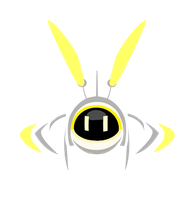
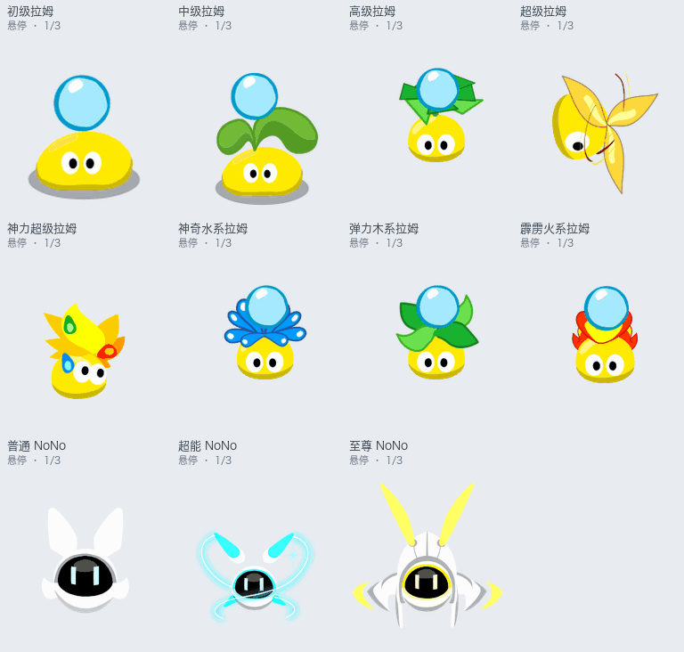

# 淘米Codex Pets · 摩尔庄园&赛尔号

网站：[mli55.github.io/taomi-codex-pets](https://mli55.github.io/taomi-codex-pets/)

拉姆与 NoNo 的 Codex pets

| 宠物 | 可选形态 |
| --- | --- |
| 普通拉姆 |    |
| 超级拉姆 |   |
| 神力拉姆 |    |
| NoNo |    |



悬停反应播放三遍后回到待机。拉姆提供原客户端的十种身体配色，NoNo 默认保留原色，也可在网站选择颜色。

## 安装

命令安装需要 Node.js 18 或更新版本。

拉姆（默认黄色神力超级拉姆）：

```sh
npx --yes github:mli55/taomi-codex-pets --form super --color 1
```

NoNo（默认超能版）：

```sh
npx --yes github:mli55/taomi-codex-pets --pet nono --variant super
```

`--variant`（NoNo）：`normal` 普通版、`super` 超能版、`annual` 至尊版。NoNo 默认保留原色，其他颜色可以在网站选好后复制对应安装命令。

`--pet`：`ram`（默认）或 `nono`。

`--form`：`junior` 初级、`middle` 中级、`senior` 高级、`classic` 超级、`super` 神力超级、`water` 水系、`wood` 木系、`fire` 火系。

`--color`：1 黄色、2 红色、3 天蓝色、4 粉红色、5 橘黄色、6 灰色、7 黑色、8 紫色、9 土色、10 绿色。

安装器只复制宠物数据到 `CODEX_HOME/pets`，默认 `~/.codex/pets`，不会覆盖已有宠物。打开 Codex「设置 → Pets / 宠物」，刷新后选择它；输入 `/pet` 唤出宠物。

也可以在网站选好形态与颜色，下载 ZIP，解压后把整个宠物文件夹放进上述目录。包内只有 `pet.json`、`spritesheet.png` 和说明文件。网页中的「复制给 Codex 的安装说明」会生成与你所选宠物一致的提示词。

本项目为非官方同人作品，宠物图像和动作来自原页游素材。角色及美术权益归上海淘米及相关权利方所有。素材来源见 [SOURCES.md](SOURCES.md)。
